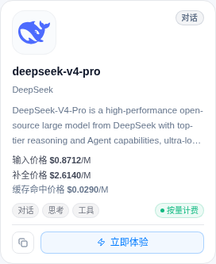

# DeepSeek V4 Pro API 调用教程：用 TryAllAPI 做 OpenAI 兼容对话接入

> **DeepSeek V4 Pro**（TryAllAPI 模型 ID：`deepseek-v4-pro`）是 DeepSeek 的高性能开源大模型档位，价格接口描述强调顶尖推理与 Agent 能力、超长上下文、昇腾芯片兼容与高性价比。价格接口标签为「对话、思考、工具」。本文记录如何通过聚合站 **[TryAllAPI](https://tryallapi.com/)**，从模型广场 / 价格页选型、读基价与分组倍率，到 `POST /v1/chat/completions` 的完整接入流程。价格与分组倍率取数 **2026-10-29（北京）**，**以页面实时为准**；示例仅为请求形态说明，未跑通真实长任务计费。

**Keywords:** DeepSeek V4 Pro · deepseek-v4-pro · TryAllAPI · OpenAI 兼容 · anthropic · `/v1/chat/completions` · Self-Deployed

---

## 目录

- [一、为什么用聚合站调 DeepSeek](#一为什么用聚合站调-deepseek)
- [二、在价格页 / 模型广场找到 DeepSeek V4 Pro](#二在价格页-模型广场找到-deepseek-v4-pro)
- [三、模型怎么选：与相邻档对照](#三模型怎么选与相邻档对照)
- [四、价格怎么读](#四价格怎么读)
- [五、调用流程：Key → Base URL → chat/completions](#五调用流程key-base-url-chatcompletions)
- [六、curl / SDK 最小示例](#六curl-sdk-最小示例)
- [七、常见注意](#七常见注意)
- [FAQ](#faq)
- [八、小结与试用入口](#八小结与试用入口)

---

## 一、为什么用聚合站调 DeepSeek

只用 DeepSeek 官方、能走官方控制台充值开票时，直连往往最干净；如果项目里还要同时调 GPT、Claude、Gemini、国内模型，为每家维护一套 Key 和重试逻辑也比较散。

聚合站（如 [TryAllAPI](https://tryallapi.com/)）的常见价值：

1. **统一鉴权**：一个 Bearer Key，切换 `model` 字段即可试不同模型；
2. **OpenAI 兼容形态**：Base URL 固定为 `https://tryallapi.com/v1`，Cursor / Dify / 各类 SDK 改地址即可；
3. **模型广场可对照**：标签、分组倍率、端点类型一目了然。

代价是多一跳：延迟与可用性取决于分组上游，建议先用小流量探针。注册试用入口：[https://tryallapi.com/register?aff=5A6A](https://tryallapi.com/register?aff=5A6A)。

---

## 二、在价格页 / 模型广场找到 DeepSeek V4 Pro

打开 [价格页](https://tryallapi.com/pricing) 或模型广场，按供应商 **DeepSeek**、类型 **对话**、关键词 `v4-pro` / `deepseek-v4-pro` 筛选。详情卡截图如下：



详情卡要点（取自价格接口 2026-10-29（北京） 快照）：

| 字段 | 内容 |
| --- | --- |
| **模型 ID** | `deepseek-v4-pro` |
| **供应商** | DeepSeek |
| **标签** | 对话、思考、工具 |
| **端点类型** | `openai`（`POST /v1/chat/completions`）、`anthropic` |
| **可用分组** | Self-Deployed-1、Self-Deployed-2、Self-Deployed-3 |
| **计费** | 按量（token） |

文中 UI 品牌可能显示为模型广场 / 第三方壳，实际对接产品以 [TryAllAPI](https://tryallapi.com/) 控制台与价格页为准。

---

## 三、模型怎么选：与相邻档对照

只根据价格接口可见信息做对照，**不编造未出现的能力差异**。基价按价格接口换算（$/1M，未乘分组倍率）：

| 模型 ID（可见） | 基价 输入 / 输出 / 缓存读 | 怎么理解 |
| --- | --- | --- |
| **`deepseek-v4-pro`** | $1.32 / $3.96 / ≈$0.044 | 本文主线：V4 Pro 档；推理 / Agent 常用 |
| `deepseek-v4-pro-0813` | $1.32 / $3.96 / ≈$0.044 | 同价位日期后缀档；换档只改 model |
| `deepseek-v4-flash` | $0.3 / $1.2 / $0.006 | 同系列 Flash 轻量档；吞吐 / 成本敏感 |
| `deepseek-v4.1-flash` | $0.3 / $1.2 / $0.006 | 同系列可见 Flash 档；对照价位用 |

实务上：经 TryAllAPI 调用统一写精确字符串 `deepseek-v4-pro`；遇限流或分组无货，再在同厂商可见 ID 之间切换，而不是改 Base URL。

---

## 四、价格怎么读

对话模型常见公式：**≈ 基价 × 分组倍率**（以控制台为准）。取数快照：**2026-10-29（北京）**；**以页面实时为准**。

换算约定：基价输入 $= model_ratio×2；输出 $= 输入×completion_ratio；缓存读 $= 输入×cache_ratio。分组估价 = 基价 × group_ratio。

### 基价（每百万 tokens，由价格接口换算）

| 计费项 | 基价（$/1M，未乘分组） |
| --- | --- |
| 输入 | **$1.32** |
| 输出 | **$3.96** |
| 缓存读 | **≈ $0.044**（输入 × 0.03333） |

公开接口按 **基价 × group_ratio** 估算即可；**实际扣费以控制台为准**。本模型价格接口未见 `step_ratios` / `cache_creation_ratio` 字段。

### 分组价格估算（基价 × group_ratio，$/1M）

| 分组 | group_ratio | 输入估 | 缓存读估 | 输出估 |
| --- | --- | --- | --- | --- |
| **Self-Deployed-1** | 0.66 | ≈ $0.8712 | ≈ $0.029 | ≈ $2.6136 |
| **Self-Deployed-2** | 1.1 | ≈ $1.452 | ≈ $0.0484 | ≈ $4.356 |
| **Self-Deployed-3** | 1.65 | ≈ $2.178 | ≈ $0.0726 | ≈ $6.534 |

**最终扣费以控制台流水为准**。

---

## 五、调用流程：Key → Base URL → chat/completions

```text
控制台创建 API Key（选本模型 enable_groups 中的分组）
  → Base URL = https://tryallapi.com/v1
  → POST /v1/chat/completions   （model=deepseek-v4-pro）
  → 读 choices[0].message.content（或流式 delta）
```

建议：

- **超时**：长输出 / 思考模式建议开流式并调高 timeout；
- **密钥**：只放环境变量（如 `TRYALLAPI_KEY`），勿提交仓库；
- **anthropic 端点**：价格接口同时标注 `anthropic` 端点类型；本文以 OpenAI 兼容 `chat/completions` 为主，其它端点以站点说明为准。

---

## 六、curl / SDK 最小示例

占位 Key `sk-xxx`（**不要**填入真实 Key）。

### 1）OpenAI 兼容 chat/completions

```bash
curl -sS https://tryallapi.com/v1/chat/completions \
  -H 'Authorization: Bearer sk-xxx' \
  -H 'Content-Type: application/json' \
  -d '{
    "model": "deepseek-v4-pro",
    "messages": [
      {"role": "user", "content": "把这段推理任务拆成可执行的验收清单（不超过 8 条）"}
    ]
  }'
```

### 2）Python（OpenAI SDK）

```python
from openai import OpenAI

client = OpenAI(
    api_key="sk-xxx",  # 建议改为读取环境变量
    base_url="https://tryallapi.com/v1",
    timeout=180,
)

r = client.chat.completions.create(
    model="deepseek-v4-pro",
    messages=[{"role": "user", "content": "用三句话说明如何给这段 Agent 工具调用写单元测试边界。"}],
)
print(r.choices[0].message.content)
```

Cursor：Settings → Models → OpenAI API Key + Override Base URL `https://tryallapi.com/v1` → 自定义模型 `deepseek-v4-pro`。Dify：OpenAI-API-compatible，endpoint 填 `https://tryallapi.com/v1`。

---

## 七、常见注意

1. **模型名**：请求体 `"model"` 必须写广场上的精确 ID `deepseek-v4-pro`（含连字符，大小写敏感）；写混成 `deepseek-v4` 或漏掉 `-pro` 容易调到 Flash 档。
2. **基价 × 倍率**：估算用价格接口快照；峰谷 / 促销字段若页面另有说明，以控制台为准。
3. **分组**：403 多为分组无货，换 `enable_groups` 里其他 Self-Deployed 分组；低倍率分组先抽检质量与延迟。
4. **报错速查**：401 查 Bearer / 令牌；404 确认模型名且 base_url 含 `/v1`；429 退避或换分组。
5. **合规**：第三方聚合不是 DeepSeek 官方服务，敏感代码先看条款。

---

## FAQ

### DeepSeek V4 Pro 的模型 ID 是什么？

TryAllAPI 上是 **`deepseek-v4-pro`**。请求体 `"model"` 填该字符串。

### TryAllAPI 的对话 endpoint 是什么？

- Base URL：`https://tryallapi.com/v1`
- 对话：`POST /v1/chat/completions`
- 价格接口同时标注 `anthropic` 端点类型；本文以 OpenAI 兼容为主。

### 基价大概是多少？

按 2026-10-29（北京） 价格接口快照：输入约 $1.32 / 输出约 $3.96 / 缓存读约 $0.044（$/1M，未乘分组）。再 × `group_ratio` 得分组估价；**以页面实时为准**。

### 如何试用 TryAllAPI？

站点首页：[https://tryallapi.com/](https://tryallapi.com/)；注册试用入口：[https://tryallapi.com/register?aff=5A6A](https://tryallapi.com/register?aff=5A6A)。

---

## 八、小结与试用入口

把 DeepSeek V4 Pro 接到业务里，核心是：**在价格页确认 model id 与 OpenAI 兼容 Base URL → 读懂基价 × 分组倍率 → 用 chat/completions 先跑通非流式 ping，再开流式 / 接工具调用**。

| 资源 | 链接 |
| --- | --- |
| TryAllAPI 首页 | [https://tryallapi.com/](https://tryallapi.com/) |
| 注册试用（aff） | [https://tryallapi.com/register?aff=5A6A](https://tryallapi.com/register?aff=5A6A) |
| 价格页 | [tryallapi.com/pricing](https://tryallapi.com/pricing) |

价格取数 2026-10-29（北京），以页面实时为准。

---

## License

本文档以个人接入笔记形式发布，示例代码可自由复用。截图与模型广场文案归原平台；价格以实时页面为准。TryAllAPI 为第三方聚合，非 DeepSeek 官方产品。
